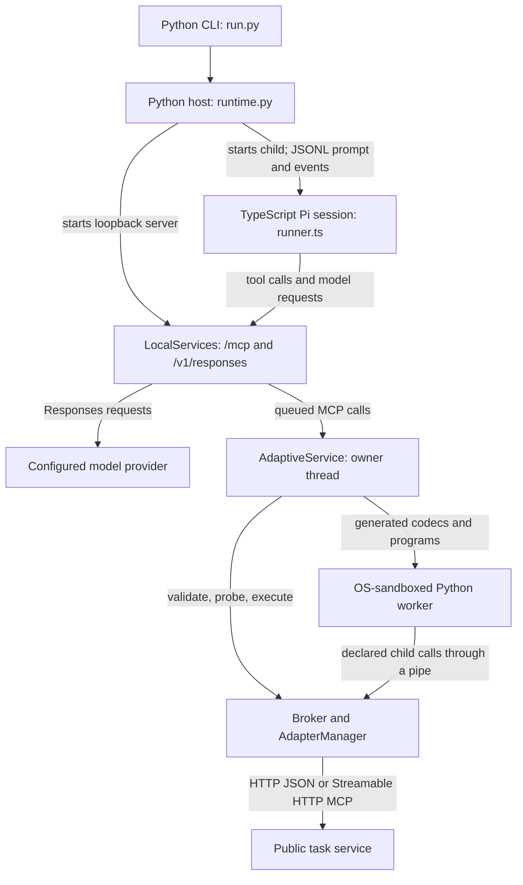

# Adaptive Pi harness: architecture and review guide

This module studies how an agent learns to use an unfamiliar task interface from
public documentation. It starts with a task instruction and service addresses,
constructs a checked interface binding, and uses feedback to repair that binding
or its task-local tools. A **binding** describes an operation's request/response
formats, effects, units, evidence requirements, and action cost.

The implementation has two main parts: a TypeScript Pi agent proposes work, and
a Python host owns validation, execution, state, and evidence. It is a standalone
research runner, not a Harbor agent plugin. It does not run EFE tasks out of the
box or produce official benchmark scores. See the [README](README.md) for setup
and the [official-run requirements](../../docs/protocol/running.md#official-runs)
for the separate benchmark execution contract.

## Read the code in this order

All paths below are relative to `harnesses/pi-adaptive/`.

| Read | Entry points | What to establish |
| --- | --- | --- |
| 1. Start a session | [run.py](python/efe_adaptive/run.py), [runtime.py](python/efe_adaptive/runtime.py): `NativeHarness.run` | Configuration, process ownership, startup, deadline, shutdown, and output files. |
| 2. Understand the agent | [runner.ts](src/runner.ts), [adaptive.md](prompts/adaptive.md) | Pinned Pi SDK session, exposed tools, hooks, and model instructions. |
| 3. Follow a tool call | [services.py](python/efe_adaptive/services.py): `LocalServices`, [service.py](python/efe_adaptive/adaptive/service.py): `AdaptiveService` | Loopback MCP/Responses endpoints, tool schemas, owner-thread queue, and returned state. |
| 4. Learn and repair an interface | [discovery.py](python/efe_adaptive/adaptive/discovery.py), [adapters.py](python/efe_adaptive/adaptive/adapters.py): `AdapterManager` | Source identities, adapter artifacts, checks, probes, registration, and invalidation. |
| 5. Check execution guarantees | [broker.py](python/efe_adaptive/adaptive/broker.py): `Broker.execute`, [programs.py](python/efe_adaptive/adaptive/programs.py), [sandbox.py](python/efe_adaptive/adaptive/sandbox.py) | Request identity, committed receipts, uncertain outcomes, and generated-program isolation. |
| 6. Check adaptation and memory | [lifecycle.py](python/efe_adaptive/adaptive/lifecycle.py), [state.py](python/efe_adaptive/adaptive/state.py), [context.ts](src/context.ts), [adaptation.ts](src/adaptation.ts), [execution-boundary.ts](src/execution-boundary.ts) | Task-local candidates, evidence-linked interpretations, legal next tools, and bounded model context. |
| 7. Reproduce the behavior | [tests/](tests/), [test/](test/) | Deterministic regression coverage and a real Pi SDK session against a scripted local model. |

## Processes and communication



There are three communication paths with different purposes:

1. **Host ↔ Pi control:** stdin/stdout JSONL carries one episode prompt and SDK
   events. `runtime.py` waits for tool discovery, then for `agent_settled`; it
   drains queued tool work while waiting. A failed/aborted model turn is not
   reported as a successful session.
2. **Pi ↔ host services:** `LocalServices` binds an ephemeral loopback port.
   `/mcp` exposes the managed harness tools; `/v1/responses` forwards and records
   model requests. HTTP handler threads enqueue tool calls; `AdaptiveService`
   executes them on its owner thread, including SQLite access and target actions.
3. **Host ↔ external services:** the host reads declared public documentation,
   invokes the target HTTP/MCP service, and contacts the configured model provider.
   Generated code has no direct network path. Effectful generated programs call
   the broker through the worker's pipe callback.

The provider key stays in the host. Pi receives a temporary loopback token and a
fresh home/configuration directory; the generated worker receives neither key.
Pi's builtin shell/file tools, user skills, extensions, and context files are not
loaded into this session. This isolation does not replace a benchmark container.

## Inputs and a complete session

| Input | Meaning | Source of truth |
| --- | --- | --- |
| `bootstrap.json` | Public task instruction, documentation entries/source roots, HTTP/MCP transport handles, optional action limit. It supplies no target action mapping, initial sensor observation, or evaluator verdict. | [bootstrap.py](python/efe_adaptive/adaptive/bootstrap.py): `BOOTSTRAP_SCHEMA` |
| `harness.json` | Explicit provider connection, deadline/timeouts, `adaptive-v1` profile, model effort mapping, and input/image limits. Credentials are named environment variables. | [runtime.py](python/efe_adaptive/runtime.py): `load_harness_config`; [pi_adaptive.py](python/efe_adaptive/pi_adaptive.py): `resolve_profile` |
| `model.json` | Model deployment and output-token/temperature settings; the model identity must match the declared profile. | [runtime.py](python/efe_adaptive/runtime.py): `NativeHarness.__init__` |

A normal bootstrap session follows this sequence:

1. The CLI validates the inputs. `NativeHarness.run` creates `BootstrapBridge`,
   the Python services, a journal/workspace, and the pinned Pi 1.3.0 process.
2. Pi calls `discover` to inspect public manuals, schemas, examples, or clients.
   `Discovery` records the source bytes and their identities. `registry` returns
   the adapter artifact/codec contract; it does not discover the interface itself.
3. Pi calls `adapter` with `propose` to submit an immutable artifact: referenced
   sources, encode/decode code, operation schemas/semantics, and public examples.
4. `validate` runs syntax, schema, transport-scope, and reference-case checks plus
   a separate model review. That review uses a fresh context and the same model
   transport/meter. It cannot override a failing deterministic check. Missing
   evidence can leave a proposal inconclusive rather than usable.
5. `probe` tries explicitly selected operations through the **same broker** used
   for task execution. A physical probe is a real action and consumes its declared
   action cost. `register` exposes only operations with passing checks and
   successful probes; validation alone does not register a tool.
6. Pi uses `execute` with the current tool version and evidence, reads the result,
   and updates evidence-linked `memory`. Changed source bytes or a runtime codec
   failure invalidate affected bindings and permit a corrected child proposal.
7. The host records the final interface report and closes the session. Agent
   completion and interface adaptation remain separate from evaluator success.

For a concrete example, the public instrument fixture changes its action field
from `delta_mm` to `delta_cm`. The drift tests require a corrected binding/version
instead of silently using the old unit mapping. A lost response is a different
case: the journal retains uncertainty, and a reviewed read-only status operation
can reconcile it without resending the action. See
[test_adaptive_discovery.py](tests/test_adaptive_discovery.py), especially
`test_drift_requires_corrected_child_and_new_version` and
`test_uncertain_dispatch_reconciles_without_duplicate_actuation`.

## Two adaptation lifecycles, not one

| Lifecycle | Tools and implementation | What changes |
| --- | --- | --- |
| External interface binding | `adapter(propose → validate → probe → register)`; `AdapterManager` in [adapters.py](python/efe_adaptive/adaptive/adapters.py) | How a public target operation is encoded, decoded, described, and made available. Source changes and runtime feedback can require repair or invalidate its scope. |
| Task-local tool or policy | `candidate → validate → activate`, or `discard`; `Lifecycle` in [lifecycle.py](python/efe_adaptive/adaptive/lifecycle.py) | A numerical helper or feedback policy under the fixed contracts in `PROTOCOLS`. This is not unrestricted rewriting of the host, evaluator, or benchmark. |

Both retain immutable parent/child records and validation evidence. Repeating a
proposal or validation reuses its existing record. A failed candidate needs a
corrected child; a closed adaptation needs new relevant evidence before another
revision. Neither lifecycle publishes changes across tasks. Policy candidates
receive independent model review; numerical helpers also have host-owned tests.

## Execution, memory, and context rules

- **Execution request:** `EXECUTION` in `adaptive/service.py` requires
  `request_id`, `tool`, `tool_version`, `arguments`, and a `decision` containing
  intent, expected outcome, evidence, policy version, and completion status.
  Obtain IDs/versions from the current registry and state rather than inventing
  them. `Broker.execute` checks admission and commits intent before dispatch.
- **Retries:** an identical request ID returns its recorded receipt; different
  content under that ID is rejected. A dispatch exception leaves an
  `indeterminate` receipt and blocks new dispatch until reconciliation. The
  journal is not an automatic simulator/session restore mechanism.
- **Received response vs. lost response:** if bytes arrived but decoding failed,
  the completed receipt retains the raw response and marks a binding error.
  Repairing a decoder must not repeat the already completed action.
- **Generated programs:** `workspace.run` provides sandboxed computation over
  declared public resources/dependencies. `runtime.program` adds reviewed,
  explicitly scoped child tool calls; each child uses the broker with a parent
  request ID. Nested programs and direct worker network access are unavailable.
- **Task memory:** `TaskState` stores claims/subgoals/feedback separately from
  chat history. Claims cite known evidence and remain model interpretations.
  Feedback and completion updates require current evidence; they do not set the
  benchmark's success flag.
- **Pi context:** `ContextBuilder` keeps the task, schemas, current evidence,
  latest exchange, and host-state projection while dropping whole older
  exchanges. Optional pinned evidence can be dropped if necessary to fit.
  Its text-byte/image estimate is a conservative budget, not exact tokenization;
  it fails if required content still cannot fit. Pi auto-compaction is disabled.
- **Next actions:** `adaptationContext` filters the advertised tools/actions using
  host state; Python still checks requests. `ExecutionBoundary` requires a new
  model request to inspect an execution result before choosing new work, with
  receipt retrieval/identical retry exceptions. Reviewed programs enforce their
  own broker-mediated child sequence.

## Evidence and outputs

The CLI creates a new run directory under the selected output root:

```text
experiment_runs/<run>/
  run.json, events.jsonl, artifacts/   # trace metadata, events, and payloads
  result.json                        # written only on successful session return
  native/
    interface-trial.json              # adaptation report and model accounting
    sessions/                        # Pi session log
    adaptive/
      journal.sqlite                 # requests, receipts, observations, audit
      sources/, adapters/, candidates/
      workspace/                     # resource/dependency manifest and outputs
```

[telemetry/](python/efe_adaptive/telemetry/) records content-addressed artifacts
and checks storage capacity. [native_events.py](python/efe_adaptive/native_events.py)
records SDK events; [services.py](python/efe_adaptive/services.py) meters actual
provider requests, including review requests, without adding SDK usage again.
Failed sessions retain trace evidence and, once the local runtime has started,
`interface-trial.json`. Outputs remain ignored by Git.

`local_adaptation_status` reports interface interaction. The standalone runner
sets `official: false`, `task_success: null`, and an unscorable task outcome.
Scripted fixture results are not evidence of autonomous model task performance.

## Validation map for human and agent reviewers

| Behavior to verify | Tests |
| --- | --- |
| Bootstrap discovery, independent examples, drift/repair, HTTP/MCP, RGB-D resources, real pinned SDK | [test_adaptive_discovery.py](tests/test_adaptive_discovery.py) |
| Duplicate/conflicting IDs, interrupted intent, uncertain dispatch, sandbox boundary | [test_broker.py](tests/test_broker.py) |
| Pending candidate progression, cached review, discard/rollback, effectful program child receipts | [test_lifecycle.py](tests/test_lifecycle.py) |
| Review transport, provider backoff, infrastructure failure | [test_transport.py](tests/test_transport.py) |
| Standalone CLI, config rejection, credential isolation, failed-session evidence | [test_standalone.py](tests/test_standalone.py) |
| Context pairing/budgets, tool availability, model-turn execution boundary | [test/](test/) |

After the [README installation steps](README.md#install-and-check), run from this
directory:

```sh
.venv/bin/python -m pytest -q
npm run check
npm test
.venv/bin/ruff format --check python tests
.venv/bin/ruff check python tests --select F
PYTHONPATH=python .venv/bin/python -m efe_adaptive.run --check \
  --bootstrap examples/bootstrap.json \
  --harness-config examples/harness.json \
  --model-config examples/model.json
```

The verified migration baseline is 52 Python tests and 10 TypeScript tests passing
on macOS, Python 3.13, and Node.js 26. The end-to-end SDK fixture uses scripted
local Responses events; no real provider credentials or paid calls are needed.
OS sandbox availability is required. Linux needs usable bubblewrap/user
namespaces and has not been validated in this migration.

## Merge scope and remaining integration work

This contribution only adds `harnesses/pi-adaptive/`. Merging it makes an opt-in
module available; it does not install dependencies into the root project or
select Pi for any existing run. The module's tests must be run explicitly using
the commands above; this contribution does not add them to repository CI.

Before treating it as an EFE runner, a separate integration needs to establish
the Harbor/container lifecycle, task-specific wire protocol (including an RCB1
decoder where needed), official agent/network/accounting requirements, and the
independent evaluator result path. Real Linux task runs and resource behavior
also need validation. This PR supplies no oracle/nop runs or benchmark scores.

The existing repository-wide checks could not complete locally because macOS
Bash 3.2 rejects an array operation and GNU `timeout` is unavailable. Those checks
have not been marked as passing. Keep their Linux CI result separate from this
module's local tests.

Imported code retains [Apache-2.0](LICENSE) with [NOTICE](NOTICE); the existing
repository's root MIT license is unchanged. The migration excludes historical
experiment results, deployment settings, and private repository history.
